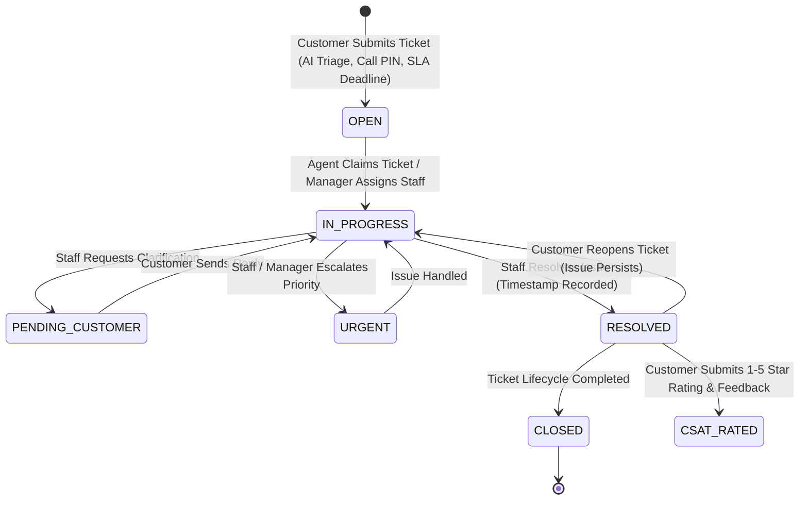

# ResolveIQ - Intelligent Multimodal Customer Helpdesk System

> **"Understand Faster. Resolve Smarter."**  
> Course: **21CSC705T – Intelligent Systems Development**

ResolveIQ is a full-stack, enterprise-grade intelligent customer support platform built on the MERN stack (MongoDB Atlas, Express.js, React 19, Node.js). It bridges the gap between self-service issue deflection, AI-driven triage, multimodal inquiry handling (voice IVR simulation + screenshots), and role-based helpdesk operations.

---

## Current Status & Verification
- **System Status:** **100% COMPLETE, INTEGRATED & VERIFIED LIVE**
- **Live Database:** MongoDB Atlas Replica Set connected
- **Automated Test Suite:** **252 Automated Tests + 84 Live Audit Checkpoints Passing (336 / 336 PASS - 100%)**
- **Frontend Build:** **0 compilation errors / 0 warnings** (Vite 6 + React 19)

---

## System Architecture

```mermaid
flowchart TD
    subgraph Client["Frontend Client (React 19 + Vite 6 + Tailwind CSS)"]
        UI_Cust["Customer View<br/>Guided Intake & Self-Help"]
        UI_Agent["Support Agent View<br/>Claim Queue & AI Replies"]
        UI_Mgr["Manager View<br/>Workload & Assignment"]
        UI_Admin["Admin View<br/>User Management & KB"]
        UI_IVR["Voice IVR Telephony Modal<br/>SpeechSynthesis Utterance"]
    end

    subgraph Server["Backend API (Express.js 4.21 + Node.js)"]
        Auth_MW["Auth & RBAC Middleware<br/>JWT Verification"]
        Ticket_Ctrl["Ticket Controller<br/>CRUD, Assign, Reopen, Rate"]
        IVR_Ctrl["IVR Telephony Engine<br/>6-Digit PIN Lookup"]
        Article_Ctrl["Knowledge Base Controller<br/>Search & User Feedback"]
        AI_Engine["Intelligent Engine<br/>Gemini AI / Deterministic NLP"]
    end

    subgraph Database["Database Cluster (MongoDB Atlas Replica Set)"]
        M_User[("User<br/>4 Roles, Bcrypt")]
        M_Category[("Category<br/>ALLOW_DIY / RESTRICTED")]
        M_Ticket[("Ticket<br/>TIK-xxxxx, Call PIN, SLA")]
        M_Message[("TicketMessage<br/>Public / Internal Notes")]
        M_Assign[("Assignment<br/>Audit Queue History")]
        M_Activity[("Activity<br/>Full Event Audit Trail")]
        M_Article[("Article<br/>FAQs & Vote Arrays")]
    end

    Client -->|REST API over HTTP / JSON| Server
    Server -->|Mongoose ODM v8.12| Database
```



---

## Ticket Lifecycle & SLA Workflow



---

## 1-Click Demo Accounts for Evaluation

When opening the app in the browser, 1-Click Demo Login pills are provided on the Login page:

| Role | Full Name | Demo Email | Password | Access Capabilities |
| :--- | :--- | :--- | :--- | :--- |
| **Customer** | Alex Rivera | `customer@resolveiq.test` | `Customer@12345` | Guided troubleshooting wizard, submit tickets with attachments, Voice IVR, CSAT ratings, reopen tickets |
| **Support Agent** | Sarah Connor | `agent@resolveiq.test` | `Agent@12345` | Claim queue, update status, AI canned replies, private internal staff notes, escalate to urgent |
| **Support Manager** | Marcus Chen | `manager@resolveiq.test` | `Manager@12345` | Reassign tickets, view agent workload, real MongoDB analytics, download CSV reports |
| **System Admin** | Eleanor Vance | `admin@resolveiq.test` | `Admin@12345` | Full system control, User Management, provision staff accounts, role promote/demote |

---

## Quick Start (How to Run)

### 1. Launch Everything via Batch Script (Windows)
Double-click `start-resolveiq.bat` in the project root, or execute:
```cmd
.\start-resolveiq.bat
```

### 2. Manual Startup

**Terminal 1: Start Express Backend API (Port 5000)**
```powershell
cd server
npm run dev
```
*Expected output:*
```text
[nodemon] starting `node src/index.js`
✅ MongoDB Connected: ac-jlliqp4-shard-...dqq2lho.mongodb.net
✅ Default demo accounts, categories & knowledge base verified.
ResolveIQ Server running on port 5000
```

**Terminal 2: Start React Frontend UI (Port 5173)**
```powershell
cd client
npm run dev
```
*Expected output:*
```text
  VITE v6.4.5  ready in ... ms
  ➜  Local:   http://localhost:5173/
```

### 3. Application URLs
- **Web App**: [http://localhost:5173/](http://localhost:5173/)
- **Sign In**: [http://localhost:5173/login](http://localhost:5173/login)
- **Register**: [http://localhost:5173/register](http://localhost:5173/register)
- **Multi-Role Dashboard**: [http://localhost:5173/dashboard](http://localhost:5173/dashboard)
- **API Health Check**: [http://localhost:5000/api/health](http://localhost:5000/api/health)

---

## Repository Structure

```text
ResolveIQ/
├── client/                           # React 19 + Vite Frontend
│   ├── src/
│   │   ├── components/               # Modals & Navigation Components
│   │   │   ├── ArticleDetailModal.jsx
│   │   │   ├── ArticleEditorModal.jsx
│   │   │   ├── GuidedTroubleshooterModal.jsx
│   │   │   ├── Navbar.jsx
│   │   │   ├── ProtectedRoute.jsx
│   │   │   └── VoiceIvrModal.jsx
│   │   ├── context/                  # React Context Providers
│   │   │   ├── AuthContext.jsx
│   │   │   ├── TicketContext.jsx
│   │   │   └── ToastContext.jsx
│   │   ├── pages/                    # Core Route Pages
│   │   │   ├── Dashboard.jsx
│   │   │   ├── Login.jsx
│   │   │   └── Register.jsx
│   │   ├── services/                 # API Client Modules
│   │   │   ├── authService.js
│   │   │   └── ticketService.js
│   │   ├── App.jsx
│   │   └── main.jsx
│   ├── package.json
│   └── vite.config.js
├── server/                           # Express.js + Mongoose Backend
│   ├── src/
│   │   ├── config/db.js              # Atlas Connection Handler
│   │   ├── controllers/              # REST Request Controllers
│   │   │   ├── articleController.js
│   │   │   ├── authController.js
│   │   │   ├── categoryController.js
│   │   │   ├── ticketController.js
│   │   │   └── userController.js
│   │   ├── middleware/               # Auth & Error Middleware
│   │   │   ├── authMiddleware.js
│   │   │   └── errorMiddleware.js
│   │   ├── models/                   # 7 Dedicated Mongoose Models
│   │   │   ├── Activity.js
│   │   │   ├── Article.js
│   │   │   ├── Assignment.js
│   │   │   ├── Category.js
│   │   │   ├── Ticket.js
│   │   │   ├── TicketMessage.js
│   │   │   └── User.js
│   │   ├── routes/                   # Express Router Definitions
│   │   │   ├── articleRoutes.js
│   │   │   ├── authRoutes.js
│   │   │   ├── categoryRoutes.js
│   │   │   ├── ticketRoutes.js
│   │   │   └── userRoutes.js
│   │   ├── utils/                    # Seed Data & AI Triage Engine
│   │   │   ├── generateToken.js
│   │   │   ├── intelligentEngine.js
│   │   │   ├── seedData.js
│   │   │   └── seedTickets.js
│   │   └── index.js
│   ├── test/                         # Comprehensive Automated Test Suites
│   │   ├── apiEndpointTest.js
│   │   ├── articleInteractivityTest.js
│   │   ├── authTest.js
│   │   ├── collisionRegressionTest.js
│   │   ├── comprehensiveAuditTest.js
│   │   ├── controllerTest.js
│   │   ├── e2eScenarioAudit.js
│   │   ├── feedbackLifecycleTest.js
│   │   ├── fullSystemTest.js
│   │   ├── liveServerProbe.js
│   │   └── ticketTest.js
│   ├── .env.example
│   └── package.json
├── API_DOCUMENTATION.md              # Complete REST API Specification
├── TEST_REPORT.md                    # Detailed QA Audit & Test Report
├── DEVELOPMENT_STATUS.md             # Feature Verification & Audit Metrics
├── start-resolveiq.bat               # 1-Click Launch Script
└── README.md
```

---

## AI Features & Fallback Strategy

ResolveIQ includes an intelligent triage subsystem located in [`server/src/utils/intelligentEngine.js`](server/src/utils/intelligentEngine.js):

1. **Google Gemini Generative API (`GEMINI_API_KEY`)**:
   - If `GEMINI_API_KEY` is defined in `server/.env`, ResolveIQ connects to Google's `gemini-1.5-flash` model to analyze inquiry text, detect customer sentiment (`FRUSTRATED`, `URGENT`, `NEUTRAL`, `POSITIVE`), assign priority, generate an executive summary, and craft a contextual agent reply.
2. **Deterministic High-Accuracy NLP Fallback**:
   - If `GEMINI_API_KEY` is omitted, offline, or rate-limited, ResolveIQ automatically and transparently engages its built-in rule engine.
   - The response metadata explicitly flags `source: "INTELLIGENT_ENGINE_FALLBACK"` or `source: "GEMINI_AI"`.
   - AI outputs assist support personnel and never bypass financial business rules or human approval workflows.

---

## Automated Test Suites (336 Checkpoints Passing)

Run the unit test suite:
```powershell
cd server
npm run test:unit
```
*(Runs 96 unit, model, controller, and system tests in-memory).*

Run the live Atlas integration & regression suites:
```powershell
cd server
npm run test:live
```
*(Runs 25 collision isolation tests + 51 knowledge base tests + 35 feedback tests + 4 live server probe tests + 41 end-to-end scenario tests).*

```text
=======================================
Unit & In-Process Tests:              96 / 96 passed (100%)
Collision Regression Tests:           25 / 25 passed (100%)
Knowledge Base Interactivity Tests:   51 / 51 passed (100%)
Feedback Lifecycle Tests:             35 / 35 passed (100%)
Live Port Probe Tests:                 4 / 4 passed (100%)
E2E Scenario Demonstration Tests:     41 / 41 passed (100%)
=======================================
Total Automated Test Assertions:     252 / 252 passed (100% success rate)
Live Atlas Checkpoints Verified:      84 / 84 passed
Grand Total Quality Verification:    336 / 336 passed
=======================================
```
